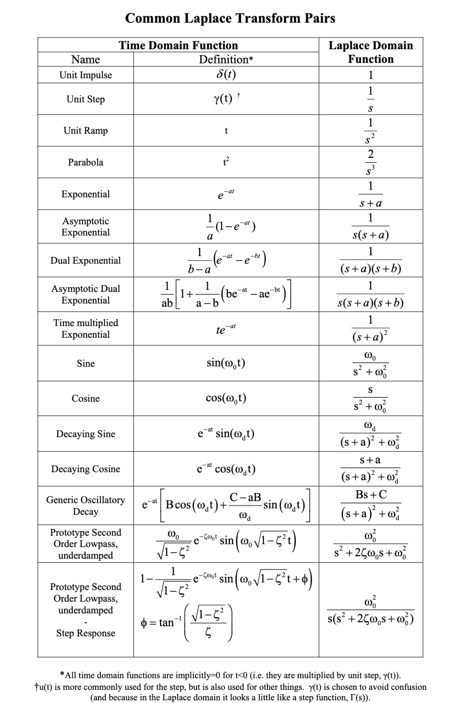
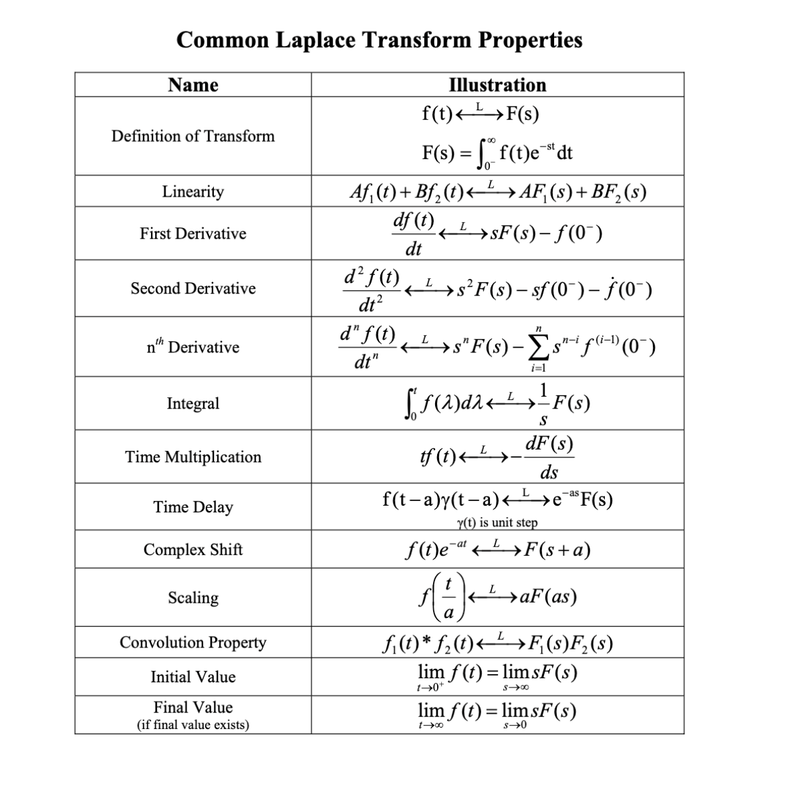

# CHMENG130-Mathematics-and-Statistics-in-Chemical-Engineering

**Week 1: First-Order Differential Equations**

* Introduction to differential equations and their classifications.
* The Euler method for numerically solving first-order ordinary differential equations (ODEs).
* Analytical solution methods for separable first-order ODEs.
* Analytical solution methods for linear first-order ODEs.
* Real-world applications of first-order ODEs: compound interest, terminal velocity, RC (resistor-capacitor) circuits, and the SIR epidemic model.

**Week 2: Homogeneous Linear Differential Equations**

* Generalizing the Euler numerical method for second-order ODEs.
* Theoretical concepts for linear equations: the principle of superposition and the Wronskian.
* Analytical solutions for homogeneous second-order ODEs with constant coefficients.
* Using an exponential ansatz to find the characteristic equation of an ODE.
* Solution methods for different characteristic root types: distinct real roots, complex-conjugate roots, and repeated roots.

**Week 3: Inhomogeneous Linear Differential Equations**

* Solving constant-coefficient ODEs with inhomogeneous terms (exponential, sine/cosine, and polynomials).
* The phenomenon of resonance (when the forcing frequency equals the oscillator's natural frequency), including damped resonance.
* Applications of inhomogeneous ODEs: RLC electrical circuits, a mass on a spring, and the pendulum.
* Nondimensionalization and dimensional analysis.

**Week 4: The Laplace Transform and Series Solution Methods**

* Definition and application of the Laplace transform for solving linear ODEs.
* Solving constant-coefficient ODEs with discontinuous or impulsive inhomogeneous terms.
* Using the Heaviside step function and the Dirac delta function.
* Solving initial value problems using transforms.
* The series solution method for linear ODEs, including application to Airy's equation.

**Week 5: Systems of Differential Equations**

* Solving coupled systems of homogeneous first-order ODEs with constant coefficients.
* Converting systems of ODEs into matrix algebra eigenvalue problems (handling distinct real and complex-conjugate eigenvalues).
* Visualizing two-dimensional solutions using phase portraits (stable/unstable nodes, saddle points, and spirals).
* Applications to coupled harmonic oscillators.
* Calculating and utilizing normal modes to analyze system motion.

**Week 6: Partial Differential Equations**

* Defining and calculating Fourier series, including Fourier sine and cosine series.
* Deriving the one-dimensional diffusion equation.
* Solving partial differential equations (PDEs) using the method of separation of variables (dividing a PDE into two ODEs).
* Using boundary conditions, ODE eigenvalues, and Fourier series to recover the full solution of the original PDE.

## W1 Summary

| Question | Main Concept | Answer |
|---|---|---|
| 7 | Product Rule / Linear First-Order ODE | $\displaystyle y=\frac{1+\sin x}{1+x^3}$ |
| 8 | Integrating Factor | $\displaystyle y=(1+x)e^{-\lambda x}$ |
| 9 | Continuous Compound Interest / Linear ODE | $\$224,000$ |
| 10 | Separable ODE / Escape Velocity | $\displaystyle \sqrt{2gR}$ |

## Differential Equations — Questions 7–10

## Question 7 — First-Order Linear ODE

Solve the differential equation

$$
(1+x^3)y' + 3x^2y = \cos x
$$

with the initial condition

$$
y(0)=1.
$$

### Solution

Notice that the left-hand side is the derivative of a product:

$$
\frac{d}{dx}\left[(1+x^3)y\right]
=(1+x^3)y' + 3x^2y.
$$

Therefore,

$$
\frac{d}{dx}\left[(1+x^3)y\right]
=\cos x.
$$

Integrate both sides:

$$
(1+x^3)y
=\int \cos x\,dx
$$

so

$$
(1+x^3)y
=\sin x + C.
$$

Therefore,

$$
y
=\frac{\sin x+C}{1+x^3}.
$$

Use the initial condition

$$
y(0)=1.
$$

Substitute $x=0$:

$$
1=
\frac{\sin 0+C}{1+0^3}.
$$

Since

$$
\sin 0=0,
$$

we get

$$
C=1.
$$

Hence,

$$
\boxed{
y(x)=\frac{1+\sin x}{1+x^3}
}
$$

### Final Answer

$$
\boxed{
\frac{1+\sin x}{1+x^3}
}
$$

---

# Question 8 — Linear ODE with Parameter $\lambda$

Solve

$$
y' + \lambda y = e^{-\lambda x}
$$

with the initial condition

$$
y(0)=1.
$$

---

### Solution

The equation is already in standard linear form:

$$
y' + P(x)y = g(x)
$$

with

$$
P(x)=\lambda.
$$

The integrating factor is

$$
\mu(x)
=e^{\int \lambda\,dx}
=e^{\lambda x}.
$$

Multiply the entire equation by $e^{\lambda x}$:

$$
e^{\lambda x}y'
+\lambda e^{\lambda x}y
=e^{\lambda x}e^{-\lambda x}.
$$

Since

$$
e^{\lambda x}e^{-\lambda x}=1,
$$

we get

$$
e^{\lambda x}y'
+
\lambda e^{\lambda x}y
=1.
$$

The left side is a product derivative:

$$
\frac{d}{dx}
\left(
e^{\lambda x}y
\right)
=1.
$$

Integrate:

$$
e^{\lambda x}y
=x+C.
$$

Therefore,

$$
y
=(x+C)e^{-\lambda x}.
$$

Use the initial condition

$$
y(0)=1.
$$

Then

$$
1
=
(0+C)e^0
$$

so

$$
C=1.
$$

Hence,

$$
\boxed{
y(x)=(1+x)e^{-\lambda x}
}
$$

### Final Answer

$$
\boxed{
y(x)=(1+x)e^{-\lambda x}
}
$$

---

# Question 9 — Mortgage Loan

A home buyer can afford to spend no more than **$1200 per month** on mortgage payments.

Suppose:

- Annual interest rate: $5\%$
- Mortgage term: $30$ years
- Interest is compounded continuously
- Payments are made continuously

Determine the maximum amount that the buyer can afford to borrow.

---

## Loan Balance Model

Let

$$
B(t)
$$

be the amount still owed after $t$ years.

The loan balance changes according to

$$
\boxed{
\text{Change in debt}
=\text{Interest added}
-\text{Payments}
}
$$

The annual payment rate is

$$
1200(12)=14400.
$$

The continuously compounded annual interest rate is

$$
r=0.05.
$$

Therefore,

$$
\boxed{
\frac{dB}{dt}=0.05B-14400
}
$$

or

$$
B'-0.05B=-14400.
$$

---

### Solve the ODE

The integrating factor is

$$
\mu(t)
=e^{\int -0.05\,dt}
=e^{-0.05t}.
$$

Multiplying by the integrating factor gives

$$
e^{-0.05t}B'
-0.05e^{-0.05t}B
=-14400e^{-0.05t}.
$$

The left side becomes

$$
\frac{d}{dt}
\left(
e^{-0.05t}B
\right)
=-14400e^{-0.05t}.
$$

Integrate:

$$
e^{-0.05t}B
=\frac{14400}{0.05}e^{-0.05t}+C.
$$

Thus,

$$
B(t)
=288000+Ce^{0.05t}.
$$

If the initial loan is $B_0$, then

$$
B(0)=B_0.
$$

Therefore,

$$
C=B_0-288000.
$$

So

$$
B(t)
=288000+
(B_0-288000)e^{0.05t}.
$$

At the end of $30$ years, the mortgage is fully paid:

$$
B(30)=0.
$$

Therefore,

$$
0
=288000+
(B_0-288000)e^{1.5}.
$$

Solving for $B_0$:

$$
B_0
=288000(1-e^{-1.5}).
$$

Numerically,

$$
B_0
\approx
223738.
$$

Rounded to the available choices,

$$
\boxed{\$224,000}
$$

### Final Answer

$$
\boxed{\$224,000}
$$

---

# Question 10 — Escape Velocity from Earth

The velocity $v=v(x)$ of a projectile satisfies

$$
v\frac{dv}{dx}
=-\frac{g}{(1+x/R)^2},
$$

where:

- $v=v(x)$ is the velocity of the projectile
- $x$ is the distance above Earth's surface
- $g$ is gravitational acceleration at Earth's surface
- $R$ is the radius of Earth

The escape velocity $v_{\text{escape}}$ is the value of

$$
v_0=v(0)
$$

such that

$$
v(x)\rightarrow0
\qquad
\text{as}
\qquad
x\rightarrow\infty.
$$

Determine the escape velocity.

---

## Solution

Start with

$$
v\frac{dv}{dx}
=-\frac{g}{(1+x/R)^2}.
$$

Separate the variables:

$$
v\,dv
=-\frac{g}{(1+x/R)^2}\,dx.
$$

Integrate both sides:

$$
\int v\,dv
=-g\int(1+x/R)^{-2}\,dx.
$$

The left side gives

$$
\frac12v^2.
$$

For the right side, let

$$
u=1+\frac{x}{R}.
$$

Then

$$
du=\frac{1}{R}dx
$$

and therefore

$$
dx=R\,du.
$$

So

$$
-gR\int u^{-2}\,du.
$$

Since

$$
\int u^{-2}\,du
=-u^{-1},
$$

we obtain

$$
\frac12v^2
=\frac{gR}{1+x/R}+C.
$$

---

### Apply the Escape Condition

For escape velocity,

$$
v(x)\rightarrow0
\qquad
\text{as}
\qquad
x\rightarrow\infty.
$$

As $x\rightarrow\infty$,

$$
\frac{gR}{1+x/R}\rightarrow0.
$$

Therefore,

$$
C=0.
$$

Hence,

$$
\boxed{
\frac12v^2
=\frac{gR}{1+x/R}
}
$$

At Earth's surface,

$$
x=0
$$

and

$$
v=v_{\text{escape}}.
$$

Therefore,

$$
\frac12v_{\text{escape}}^2
=\frac{gR}{1+0/R}.
$$

Thus,

$$
\frac12v_{\text{escape}}^2
=gR.
$$

Multiply by $2$:

$$
v_{\text{escape}}^2
=2gR.
$$

Taking the positive square root,

$$
\boxed{
v_{\text{escape}}
=\sqrt{2gR}
}
$$

### Final Answer

$$
\boxed{
v_{\text{escape}}
=\sqrt{2gR}
}
$$

---

# W2: Laplace transform for solving Linear ODE (Map T domain -> S domain , eliminate Derivative t terms)

## Question 1 — Laplace Transform with Exponential and Cosine

Find the Laplace transform of

$$
x(t) = e^{-t}\cos(\pi t)
$$

Determine

$$
X(s) = \mathcal{L}\{x(t)\}.
$$

---

## Question 2 — Laplace Transform of a Differential Equation

Consider the differential equation

$$
\ddot{x} + \dot{x} - 6x = e^{-t}
$$

with initial conditions

$$
x(0) = 0
$$

and

$$
\dot{x}(0) = 0.
$$

Take the Laplace transform of the differential equation and solve for

$$
X(s) = \mathcal{L}\{x(t)\}.
$$

---

## Question 3 — Inverse Laplace Transform

Given

$$
X(s)
=\frac{1}
{(s+1)(s+2)(s+3)},
$$

find the corresponding time-domain function

$$
x(t)
=\mathcal{L}^{-1}\{X(s)\}.
$$

Use partial-fraction decomposition as needed.

